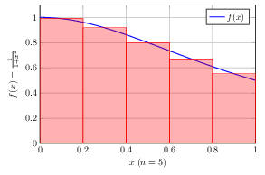

# Stima del valore di π mediante integrazione numerica

## Descrizione

Scrivere una funzione `calculate_pi(int n)` che stimi il valore di π utilizzando il metodo dei rettangoli per approssimare l'integrale:

$$
\int_0^1 \frac{1}{1+x^2} dx = \frac{\pi}{4}
$$

> [!TIP]
> Per implementare la funzione:
>
> - suddividere l'intervallo $[0, 1]$ in $n$ sottointervalli di larghezza $dx = 1/n$;
> - calcolare il valore della funzione nel punto medio di ogni rettangolo.
>
> Ecco un grafico d'esempio per n = 5:
>
> 
